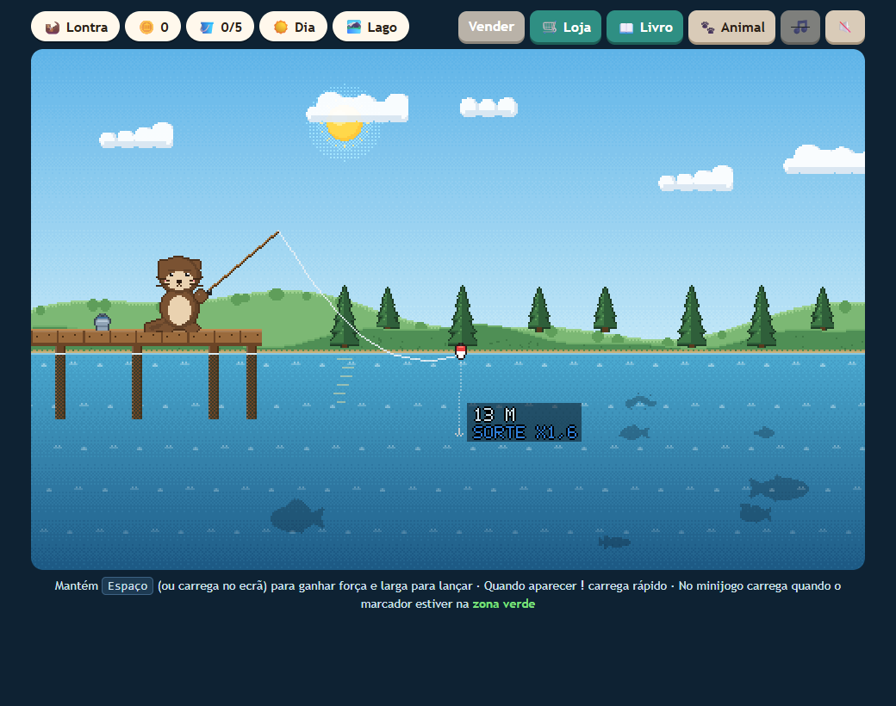

# 🎣 Pescaria

Um jogo de pesca relaxante em pixel art, feito com **Phaser 3 + Vite + TypeScript**. Escolhe um animal, lança a linha, fisga o peixe no momento certo e completa o Livro de Peixes no Lago e no Mar Profundo, de dia e de noite.

**▶️ Jogar agora:** https://alexf-9.github.io/Fishing-Game/



Toda a arte e todo o som são gerados no próprio código. O projeto não tem imagens nem ficheiros de áudio.

---

## Como se joga

| Ação | Controlo |
|---|---|
| Ganhar força e lançar | Mantém **Espaço** (ou carrega no ecrã) e larga |
| Fisgar | Carrega quando aparecer o **!** (tens cerca de 1 segundo) |
| Puxar o peixe | Carrega quando o marcador estiver na **zona verde** |
| Fechar janelas | **Espaço** no cartão do peixe, **Esc** nas restantes |

1. **Lança.** Quanto mais longe, mais fundo desce o anzol. No fundo vês a profundidade e o teu **multiplicador de sorte**.
2. **Espera** pela mordida. Se carregares antes do tempo, recolhes a linha.
3. **Fisga** quando aparecer o **!**.
4. **Puxa:** acerta 3 vezes na zona verde (4 nos peixes Épicos e Lendários). Se falhares 3 vezes, o peixe foge.
5. **Vende** o balde e gasta as moedas na loja.

### Animais
Podes trocar de animal a qualquer momento sem perder o progresso.

| Animal | Talento |
|---|---|
| 🐱 Gato | Zona verde 15% maior |
| 🐻 Urso | Peixes valem +25% de moedas |
| 🐧 Pinguim | Peixes mordem 25% mais rápido |
| 🦦 Lontra | Mais sorte com peixes raros |

### Peixes
Há 18 peixes em 5 raridades: Comum, Incomum, Raro, Épico e Lendário.

- **Lago:** Bota Velha, Peixinho Prateado, Carpa, Perca, Truta Arco-Íris, Lúcio, Peixe-Lua Noturno 🌙, Enguia Elétrica, Carpa Koi Dourada, Rei do Lago
- **Mar Profundo:** Cavala, Robalo, Polvo, Peixe-Lanterna 🌙, Peixe-Espada, Tubarão-Martelo, Peixe Cristal, Lula Gigante 🌙

🌙 = só aparece à noite. Um dia completo dura 4 minutos.

### Loja
| Upgrade | Efeito | Níveis |
|---|---|---|
| 🎣 Cana | Zona verde +12% por nível | 5 |
| 🧵 Linha | Lançamento mais longe | 5 |
| 🪱 Isco | Espera −12% por nível | 5 |
| 🍀 Amuleto da Sorte | +25% de sorte por nível | 5 |
| 🪣 Balde | +3 peixes por nível | 5 |
| ⛵ Barco | Desbloqueia o Mar Profundo | 1 |

O progresso fica guardado no browser.

---

## Destaques técnicos

- **Pixel art em código:** os 4 animais animados, os 18 peixes, os cenários, o céu, a água e uma fonte bitmap 5×7 são desenhados píxel a píxel e registados no `TextureManager` do Phaser. O jogo corre a 480×300 e é ampliado no ecrã.
- **Banda sonora adaptativa em Web Audio:**
  - Tem quatro ambientes: Lago e Mar, cada um de dia e de noite.
  - A música é composta na hora a partir de um motivo, com transições a tempo.
  - No minijogo junta-se uma camada de tensão.
  - A música baixa sozinha nos efeitos importantes.
  - Os botões 🔊 e 🎵 são independentes.
- **Regras separadas do Phaser:** o ciclo de pesca vive em `FishingController`, sem Phaser. As cenas só desenham o estado.

## Correr localmente

Precisas do [Node.js](https://nodejs.org/) 18 ou mais recente.

```bash
npm install
npm run dev        # abre em http://localhost:5173
npm run build      # gera dist/index.html (um único ficheiro que funciona sozinho)
```

O deploy no GitHub Pages é automático a cada push para o `main` (`.github/workflows/deploy.yml`).

## Testes

Os testes jogam a sério no browser com o [playwright-cli](https://www.npmjs.com/package/@playwright/cli): 49 testes do jogo e 18 da música.

```bash
npm run dev
playwright-cli open http://localhost:5173
playwright-cli run-code --filename=tests/playtest.js
playwright-cli run-code --filename=tests/music-test.js
```

As capturas de ecrã ficam em `tests/screenshots/` e as amostras de música em `tests/audio/`.

## Estrutura

```
src/
├─ art/       gerador de pixel art (animais, peixes, cenário, fonte)
├─ audio/     efeitos sonoros, mesa de mistura e banda sonora procedural
├─ data/      peixes, raridades, animais e upgrades
├─ scenes/    BootScene, GameScene (o mundo) e UIScene (barra, "!", minijogo)
├─ state/     gravação, fórmulas e eventos
├─ systems/   FishingController (regras da pesca) e DayNight
└─ ui/        HUD, loja, livro e cartão do peixe (HTML/CSS)
```

`pescaria.html` é a primeira versão do jogo, num único ficheiro com Canvas. Fica guardada como referência.
